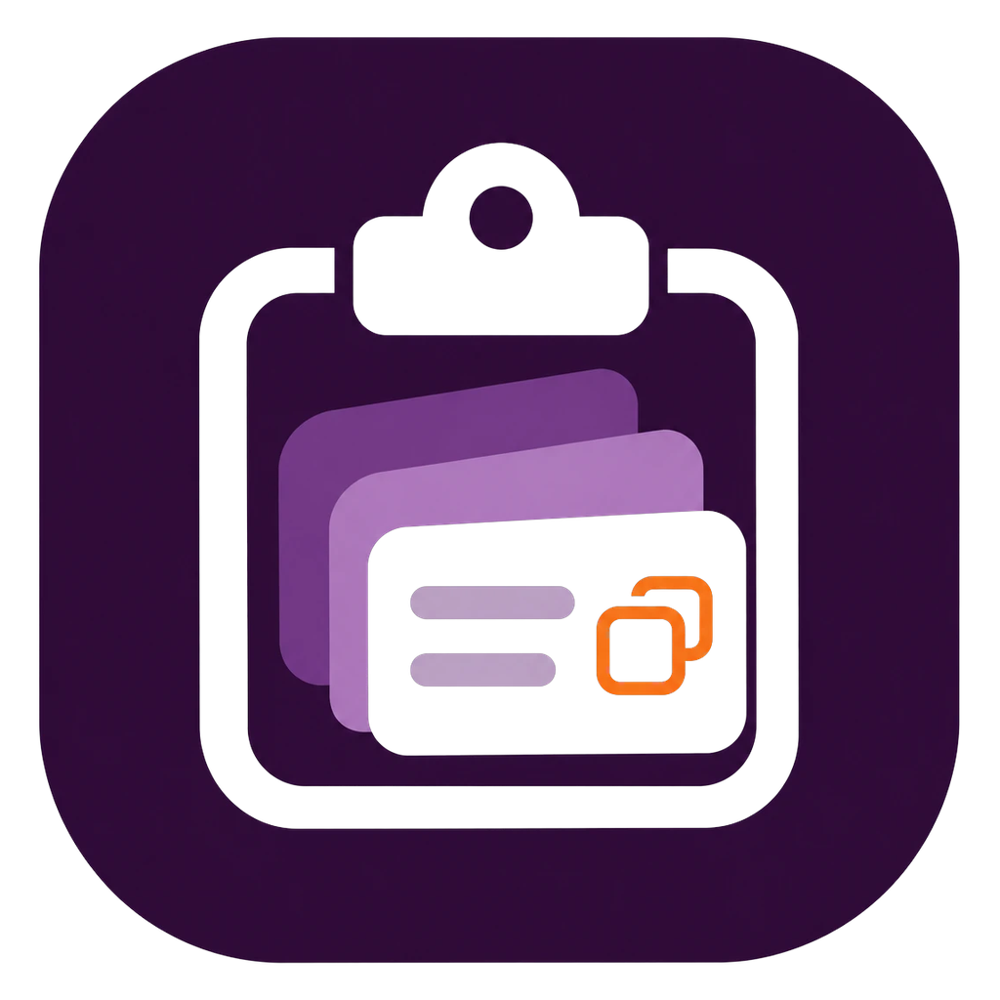
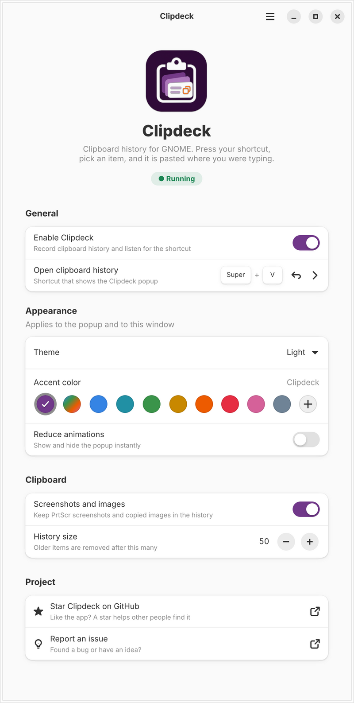
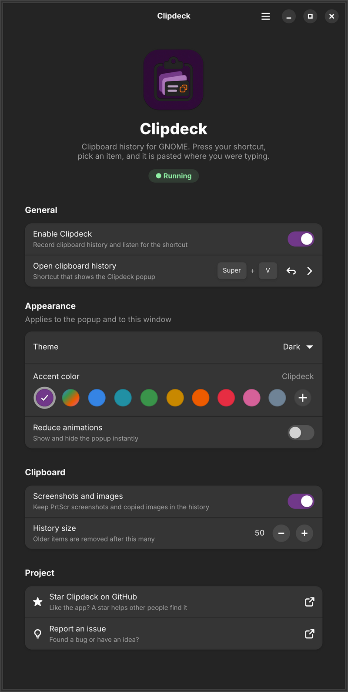

<div align="center">



# Clipdeck

**Windows-style clipboard history for GNOME.**
Press <kbd>Super</kbd> + <kbd>V</kbd>, pick anything you copied (text or screenshots), and it is pasted right where you were typing.

[](#requirements)
[](#how-it-works)
[](LICENSE)

[Install](#installation) · [Usage](#usage) · [Settings app](#settings-app) · [Troubleshooting](#troubleshooting) · [Development](#development)

</div>

---

## Features

- **Text and image history.** Everything you copy is kept, newest first. Copying the same thing again moves it back to the top instead of adding a duplicate.
- **Screenshots included.** Screenshots taken with <kbd>PrtScr</kbd> and images copied from apps such as a browser appear as thumbnail cards.
- **Pastes for you.** Click an item, or press <kbd>Enter</kbd>, and Clipdeck pastes it straight into the field you were typing in. Terminals get <kbd>Ctrl</kbd> + <kbd>Shift</kbd> + <kbd>V</kbd> automatically.
- **Opens where you type.** The popup appears at the text cursor when GNOME knows its position. Otherwise it opens over the active window.
- **Mouse or keyboard.** Click and scroll with the mouse, or use <kbd>↑</kbd> <kbd>↓</kbd> <kbd>Home</kbd> <kbd>End</kbd> <kbd>Enter</kbd> <kbd>Del</kbd>. Click outside the popup or press <kbd>Esc</kbd> to close it.
- **Light and dark themes.** Follows the GNOME style, or can be set to light or dark.
- **Your color.** Keep the Clipdeck purple, follow the GNOME accent color, pick one of the GNOME palette colors, or choose any custom color.
- **Smooth, or not.** Short open and close animations, with a *Reduce animations* switch for people who prefer none.
- **Respects secrets.** Entries that password managers mark as secret are never stored.
- **Settings app.** Turn Clipdeck on or off, change the shortcut, and detect and fix shortcut conflicts. The same settings are also available in the GNOME **Extensions** app.

## Screenshots

<p align="center">
  
  &nbsp;
  
</p>

## Requirements

| | Minimum |
| --- | --- |
| Desktop | GNOME Shell 45 – 50 (Wayland or X11) |
| Distribution | Ubuntu 24.04 LTS or newer, or any distribution with the versions below |
| Settings app | `gjs`, GTK 4.14+, libadwaita 1.5+ |

## Installation

### Option 1: `.deb` package (Ubuntu / Debian)

Build the package from source, then install it with apt, which also pulls in the dependencies:

```bash
git clone https://github.com/divasatriaa/clipdeck.git
cd clipdeck
make deb
sudo apt install --reinstall ./dist/clipdeck_0.2.0_all.deb
```

Then **log out and back in** (GNOME Shell only discovers new extensions at login), open **Clipdeck** from the app grid and switch on **Enable Clipdeck**.

> [!TIP]
> `--reinstall` makes apt replace the files even when the version number has not changed, for example after pulling new commits.

To remove it:

```bash
sudo apt remove clipdeck
```

### Option 2: From source (per user, no root)

```bash
git clone https://github.com/divasatriaa/clipdeck.git
cd clipdeck
make install
```

Then log out and back in, and open **Clipdeck** from the app grid. Remove it again with `make uninstall`.

> [!NOTE]
> If you have both a source install (in `~/.local`) and the `.deb`, GNOME uses the copy in your home folder. Run `make uninstall` before switching to the package.

## Usage

| Action | How |
| --- | --- |
| Open the history | <kbd>Super</kbd> + <kbd>V</kbd> (configurable) |
| Paste an item | Click it, or select it and press <kbd>Enter</kbd> |
| Move through items | Mouse wheel, or <kbd>↑</kbd> <kbd>↓</kbd> <kbd>Home</kbd> <kbd>End</kbd> |
| Remove one item | Select it and press <kbd>Del</kbd> |
| Remove everything | **Clear all** button |
| Close without pasting | Click outside the popup, press <kbd>Esc</kbd>, or press the shortcut again |

History is kept in memory and cleared when you log out. Images are stored temporarily in `~/.cache/clipdeck/images` and deleted along with their entries.

## Settings app

The **Clipdeck** app in your app grid controls the extension. The same settings (except the on/off switch) are also available from the ⚙ button next to Clipdeck in the **Extensions** app.

| Setting | What it does |
| --- | --- |
| **Enable Clipdeck** | Turns the extension on or off (the same as the Extensions app) |
| **Open clipboard history** | Records a new shortcut. The ↺ button resets it to <kbd>Super</kbd> + <kbd>V</kbd> |
| **Theme** | Follow system, light or dark, for both the popup and the app |
| **Accent color** | Clipdeck purple, *Follow system* (GNOME 47+ accent color), a GNOME palette color, or any custom color with **+**. The app previews it straight away |
| **Reduce animations** | Shows and hides the popup instantly |
| **Screenshots and images** | Whether copied images and screenshots are kept |
| **History size** | How many items are kept (10–200) |

When another GNOME shortcut already uses the same keys, for example the notification list or a custom shortcut left over from another clipboard manager, the app shows a banner naming it. Clicking **Free Shortcut** removes the key combination from those shortcuts.

All settings are also available from the command line:

```bash
gsettings list-recursively org.gnome.shell.extensions.clipdeck
```

## Troubleshooting

<details>
<summary><b>Pressing Super + V does nothing</b></summary>

Another shortcut is taking the key first. Open the Clipdeck app: it lists the conflicting shortcut and can free it. Common culprits:

- GNOME's notification list (`toggle-message-tray`), which uses <kbd>Super</kbd> + <kbd>V</kbd> by default
- A custom shortcut from another clipboard manager, such as CopyQ, under *Settings → Keyboard → Custom Shortcuts*

To check manually:

```bash
dconf dump / | grep -i -B3 "super>v"
```

</details>

<details>
<summary><b>The app says an older Clipdeck installation is still active</b></summary>

Clipdeck found an old copy of its settings schema, usually because the `.deb` and `make install` were mixed, or because apt skipped a package with the same version number. Remove every copy, then install one way only:

```bash
make uninstall
sudo apt remove clipdeck
sudo apt install --reinstall ./dist/clipdeck_0.2.0_all.deb
```

Log out and back in afterwards.

</details>

<details>
<summary><b>The app says “Log out and back in to finish installing”</b></summary>

GNOME Shell has not loaded the extension yet. This is expected right after installing on Wayland. Log out and back in.

</details>

<details>
<summary><b>Something else is wrong</b></summary>

Follow the GNOME Shell log while you reproduce the problem, and include the output in an [issue](https://github.com/divasatriaa/clipdeck/issues):

```bash
journalctl -f -o cat /usr/bin/gnome-shell | grep --line-buffered -i clipdeck
```

</details>

## How it works

On GNOME Wayland, only the focused window receives clipboard events, and GNOME's compositor (Mutter) does not offer the data-control protocol that clipboard managers use on other desktops. A normal background app therefore cannot see what you copy.

Clipdeck runs as a GNOME Shell extension instead. Inside the shell it can listen to the clipboard, register a global shortcut, and send a paste keystroke through a virtual keyboard. A separate GTK 4 / libadwaita app edits its settings through GSettings and turns it on and off over GNOME Shell's D-Bus interface.

```text
 copy / PrtScr ──► Meta.Selection "owner-changed" ──► history (memory + image cache)
                                                            │
 Super+V ──► popup (St widgets, modal) ──► click / Enter ───┘
                                               │
                     St.Clipboard.set_*() ◄────┘
                               │
                     virtual keyboard sends Ctrl+V ──► focused app

 Clipdeck app ──► GSettings (theme, shortcut, …) ──► extension
              └─► org.gnome.Shell.Extensions (D-Bus) ──► enable / disable
```

## Development

```text
extension/   GNOME Shell extension: extension.js, prefs.js, settingsUi.js (shared
             settings widgets), stylesheet.css, metadata.json, schemas/
app/         Settings app (GJS + GTK 4 + libadwaita) and its launcher
data/        Desktop entry, AppStream metadata, icons
debian/      Source package for Launchpad PPAs (dpkg-buildpackage / debuild)
packaging/   Control file for the quick `make deb` build
docs/        Screenshots and the publishing guide
assets/      Logo
```

| Command | What it does |
| --- | --- |
| `make install` | Install the extension and the app for the current user |
| `make uninstall` | Remove both again |
| `make run-app` | Run the settings app straight from the source folder |
| `make pack` | Build the extension zip for extensions.gnome.org into `dist/` |
| `make deb` | Build the `.deb` package into `dist/` |
| `make ppa-source` | Build a signed source package for a Launchpad PPA |
| `make enable` / `make disable` | Turn the extension on or off |
| `make logs` | Follow GNOME Shell logs |

After changing the extension on Wayland, run `make install` and log out and back in. To test without logging out, run a nested shell in a window:

```bash
# GNOME 49 and newer (needs the mutter devkit package)
dbus-run-session gnome-shell --devkit --wayland

# GNOME 45–48
dbus-run-session -- gnome-shell --nested --wayland
```

### Building the `.deb` package

```bash
make deb MAINTAINER="Your Name <you@example.com>"
```

The package is written to `dist/clipdeck_<version>_all.deb`. It installs the extension system-wide in `/usr/share/gnome-shell/extensions`, the settings schema in `/usr/share/glib-2.0/schemas`, and the app in `/usr/share/clipdeck`, with a `clipdeck` launcher and a desktop entry.

### Publishing

Step-by-step guides for extensions.gnome.org and a Launchpad PPA are in [docs/PUBLISHING.md](docs/PUBLISHING.md).

## Roadmap

- [x] Text history, popup, paste into the focused app
- [x] Image and screenshot support
- [x] Mouse support, click outside to close
- [x] Light and dark themes, accent colors, reduced motion
- [x] Settings app, Extensions-app preferences and `.deb` / PPA packaging
- [ ] Search and pinned items
- [ ] Save history to disk across sessions
- [ ] Exclude apps (for example password managers)
- [ ] Publish on extensions.gnome.org and in a PPA (see [docs/PUBLISHING.md](docs/PUBLISHING.md))

## Contributing

Bug reports, ideas and pull requests are welcome. Please open an [issue](https://github.com/divasatriaa/clipdeck/issues) first for larger changes. If Clipdeck is useful to you, consider giving the project a ⭐.

## License

Clipdeck is free software, released under the [GNU General Public License v2.0 or later](LICENSE).
